 

<!--- RADAR & FOCUS --->

 

 

 

<!--- OPEN SOURCE CONTRIBUTIONS --->

<b>6 featured merges</b> · 4 open-source projects

<!-- Individual linked images wrap to one column on narrow screens. -->

<a href="https://github.com/search?q=is%3Apr+is%3Amerged+author%3Aadityamukesh&amp;type=pullrequests">View all merged pull requests ↗</a>

<b>More contributions · open pull requests</b>

| Project | Contribution |
| :--- | :--- |
| **Kinshow** | [#433 · Unify button variants](https://github.com/kiinshuk/kinshow/pull/433) |
| **Sentri** | [#162 · Contributor architecture map](https://github.com/SahilKumar75/Sentri/pull/162) |
| **JabRef** | [#17441 · Preserve BibTeX syntax highlighting](https://github.com/JabRef/jabref/pull/17441) |

 

 

<!--- SELECTED WORK --->

 

<table width="100%" cellspacing="0" cellpadding="0" border="0">
<tr>
<td width="50%" valign="top" align="left">

</td>
<td width="50%" valign="top" align="right">

</td>
</tr>
<tr>
<td colspan="2" valign="top">
 
</td>
</tr>
<tr>
<td width="50%" valign="top" align="left">

</td>
<td width="50%" valign="top" align="right">

</td>
</tr>
</table>

 

 

<!--- ENGINEERING & TECH STACK --->

 

 

 

 

<!--- COMPETITIVE PROGRAMMING --->

 

 

&nbsp;

&nbsp;

 

 

<!--- CONTRIBUTION & GITHUB ACTIVITY --->

 

 

&nbsp;&nbsp;

 

 

 

<!--- CONNECT & ELSEWHERE --->

 

&nbsp;

&nbsp;

&nbsp;

&nbsp;

 

