

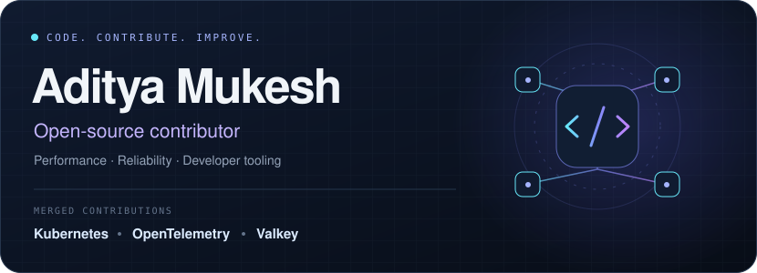

<a href="#linux-foundation--cncf-contributions">Featured contributions</a> · <a href="https://github.com/adityamukesh?tab=repositories">Repositories</a> · <a href="https://www.linkedin.com/in/aditya-mukesh-13a804377/">Connect</a>

 

<!--- OPEN SOURCE CONTRIBUTIONS --->

<!-- CONTRIBUTIONS:START -->

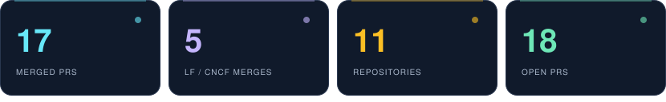

Public contributions to other owners’ repositories · refreshed 2026-10-29 · updates daily

<h3 align="center">Linux Foundation &amp; CNCF contributions</h3>

<b>5 merged PRs</b> across Kubernetes, OpenTelemetry and Valkey

<a href="https://github.com/kubernetes-sigs/inference-perf/pull/936">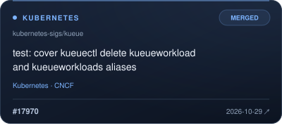</a>
<a href="https://github.com/open-telemetry/opentelemetry-kotlin/pull/1329">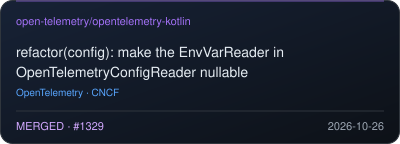</a>
<a href="https://github.com/open-telemetry/otel-arrow/pull/4424">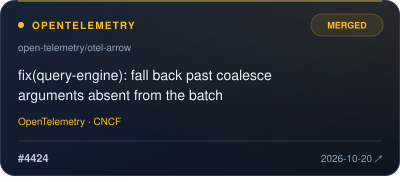</a>
<a href="https://github.com/valkey-io/valkey/pull/4843">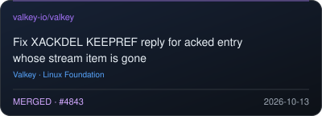</a>

<h3 align="center">More open-source contributions</h3>

<a href="https://github.com/oss-slu/mithridatium/pull/146">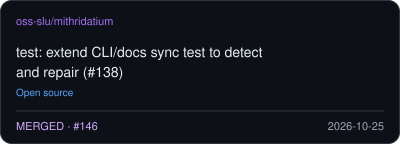</a>
<a href="https://github.com/oss-slu/mithridatium/pull/145">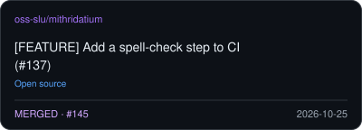</a>
<a href="https://github.com/kiinshuk/kinshow/pull/433">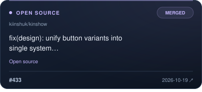</a>
<a href="https://github.com/wboayue/rust-ibapi/pull/1011">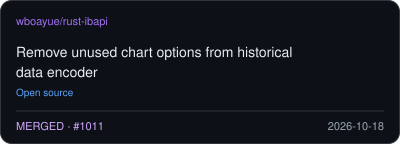</a>
<a href="https://github.com/ciaren-labs/Ciaren/pull/259">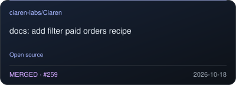</a>

[View all merged pull requests](https://github.com/search?q=is%3Apr+is%3Amerged+is%3Apublic+author%3Aadityamukesh+-user%3Aadityamukesh&type=pullrequests)

<b>Recent open pull requests</b>

| Project | Contribution |
| :--- | :--- |
| open-telemetry/opentelemetry-kotlin | [#1354 · fix: guard init-time user code with SdkErrorHandler](https://github.com/open-telemetry/opentelemetry-kotlin/pull/1354) |
| open-telemetry/otel-arrow | [#4575 · perf(query-engine): skip selection vectors for scalar predicates](https://github.com/open-telemetry/otel-arrow/pull/4575) |
| kubernetes-sigs/image-builder | [#2190 · test(azure): cover CI authentication isolation](https://github.com/kubernetes-sigs/image-builder/pull/2190) |
| JabRef/jabref | [#17441 · Preserve syntax highlighting when copying BibTeX in Source tab (#17392)](https://github.com/JabRef/jabref/pull/17441) |
| valkey-io/valkey | [#5009 · Deflake Backlog cursor stays pinned repl-compression test](https://github.com/valkey-io/valkey/pull/5009) |
| codearena-oss/codearena | [#55 · test: cover public problem page behavior](https://github.com/codearena-oss/codearena/pull/55) |
| SahilKumar75/Sentri | [#162 · docs(repo): add repository architecture map for contributors](https://github.com/SahilKumar75/Sentri/pull/162) |
| vikas0799/shopsphere | [#455 · feat: add GitHub Actions CI workflow and README badge](https://github.com/vikas0799/shopsphere/pull/455) |
| vikas0799/shopsphere | [#454 · feat: add persistent dark mode toggle](https://github.com/vikas0799/shopsphere/pull/454) |
| vikas0799/shopsphere | [#453 · feat: show toast notification when product is added to cart](https://github.com/vikas0799/shopsphere/pull/453) |

<!-- CONTRIBUTIONS:END -->

 

<!--- RADAR & FOCUS --->

 

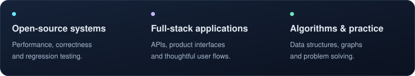

 

<!--- SELECTED WORK --->

 

<a href="https://github.com/adityamukesh/shopsphere">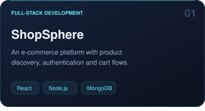</a>
<a href="https://github.com/adityamukesh/dsa--assignment">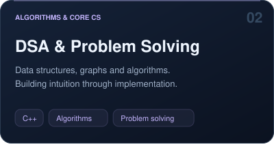</a>
<a href="https://github.com/adityamukesh/ADITYA-MUKESH">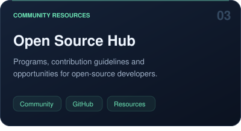</a>
<a href="https://github.com/adityamukesh/fintech">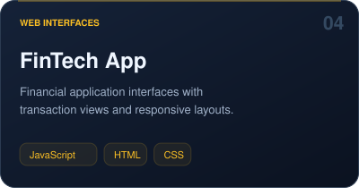</a>

 

<!--- ENGINEERING & TECH STACK --->

 

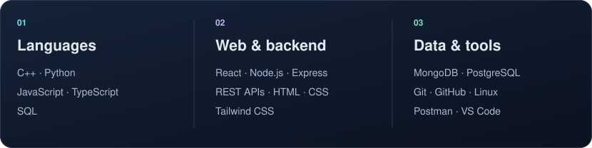

 

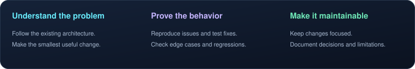

 

<!--- COMPETITIVE PROGRAMMING --->

 

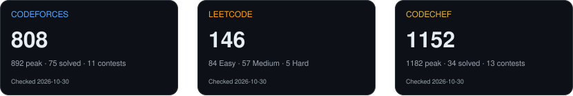

 

<a href="https://codeforces.com/profile/adityamukesh111">Codeforces ↗</a> · <a href="https://leetcode.com/u/aditya_mukesh123/">LeetCode ↗</a> · <a href="https://www.codechef.com/users/coder_baby12">CodeChef ↗</a>

 

<!--- CONTRIBUTION & GITHUB ACTIVITY --->

 

<a href="https://github.com/adityamukesh">
  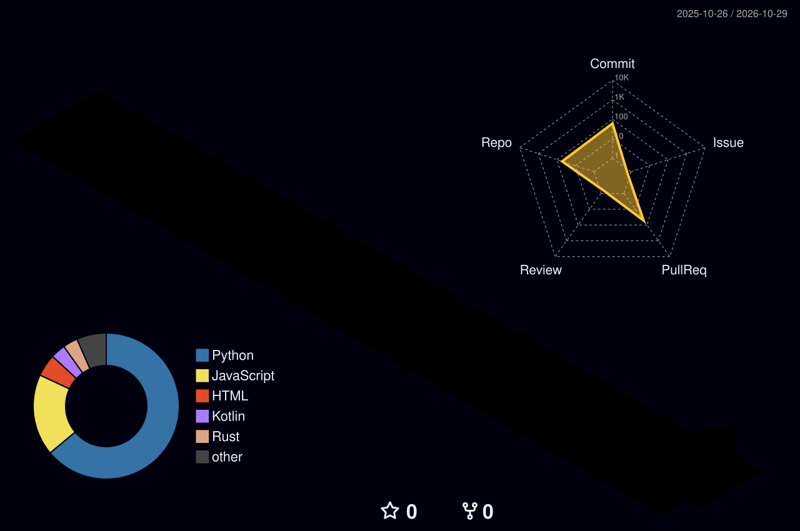
</a>

 

<a href="https://github.com/adityamukesh#js-contribution-activity-description">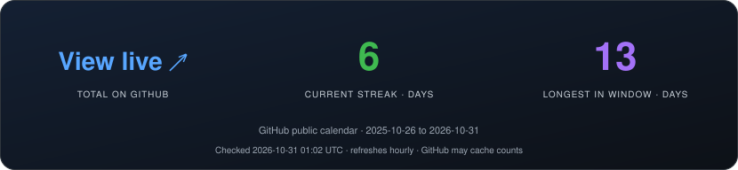</a>

 

<!--- CONNECT & ELSEWHERE --->

 

<a href="https://www.linkedin.com/in/aditya-mukesh-13a804377/">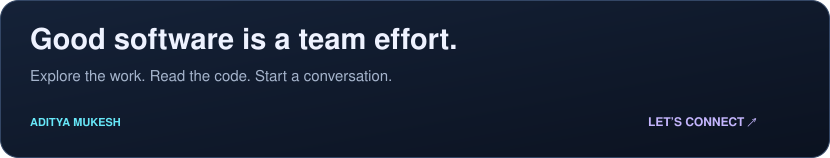</a>

<a href="https://www.linkedin.com/in/aditya-mukesh-13a804377/">LinkedIn</a> · <a href="https://github.com/adityamukesh?tab=repositories">GitHub repositories</a> · <a href="#linux-foundation--cncf-contributions">Back to featured work ↑</a>

